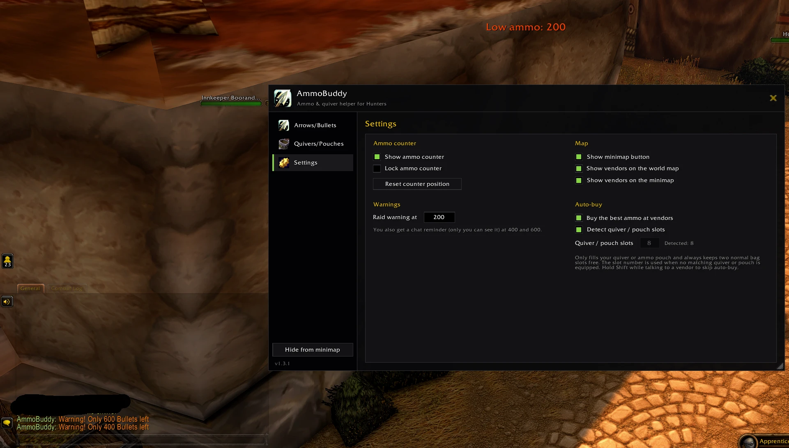
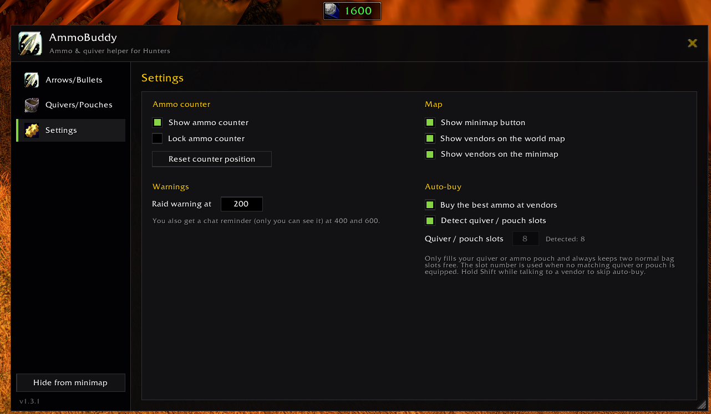
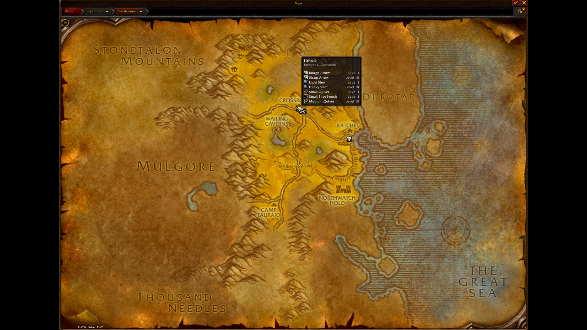
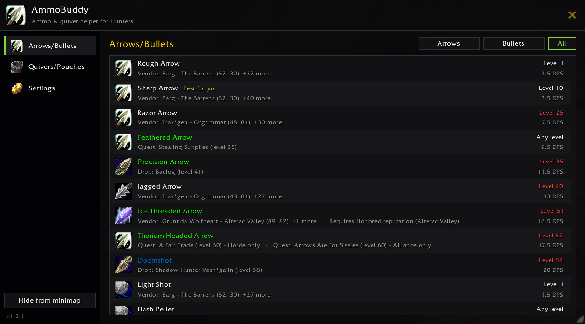
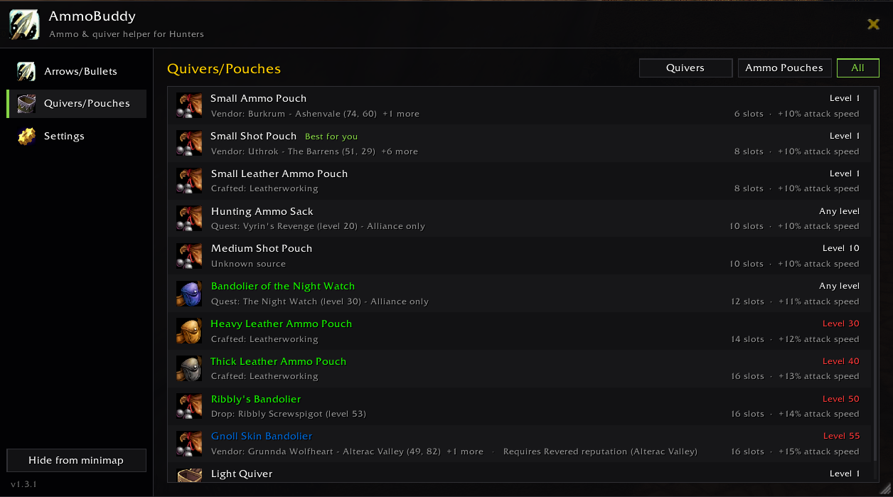
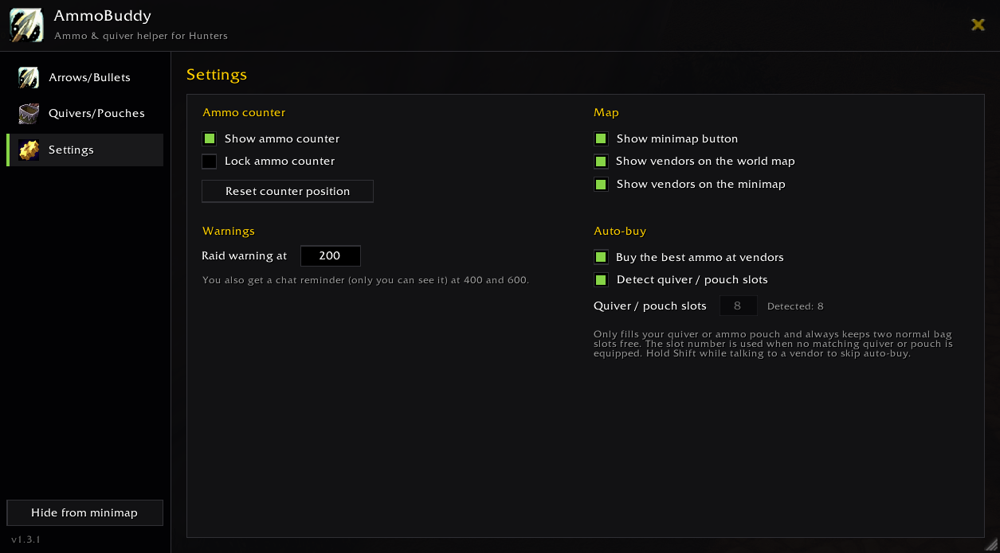

# AmmoBuddy

**Never run dry mid-pull again.** AmmoBuddy is a lightweight ammo companion for Hunters. It tracks your arrows and bullets, warns you *before* you run out, shows you where to restock on your maps, and refills your quiver for you.

Built for **WoW Forever**, and it also runs on **Classic Era / Anniversary / TBC**.

## Features

### Ammo counter & warnings
- **Live ammo counter**: a small, movable frame with your ammo icon and the total count in your bags. Hover it to see your ammo's tooltip, right-click it to open AmmoBuddy.
- **Color-coded at a glance**: green when you're stocked, yellow when you're running low, red when you're empty.
- **Low-ammo raid warning**: a big on-screen warning and sound when you drop below your threshold (default: 200). It fires once and resets after you restock.
- **Early chat reminders**: two private chat messages, 400 and 200 shots before the raid warning (e.g. at 600 and 400). Only you can see them, so you can plan your next vendor stop.

### Ammo vendors on your maps
- Every vendor that sells **arrows, bullets, quivers or ammo pouches** is shown on the **world map** and the **minimap**.
- Hover a pin to see everything that vendor sells, with the required level (red when it's still too high for you).
- Only vendors friendly to your faction are shown.
- Works with the default world map, map addons built on it, and **[OpenMap](https://github.com/openmap-world/openmap)**'s seamless world map (there you also see vendors in neighbouring zones).
- Turn the world map and minimap pins on or off separately.

### Auto-buy
- Talk to an ammo vendor and AmmoBuddy buys the **best arrows or bullets for your weapon and level** (bow and crossbow: arrows, gun: bullets).
- It **only fills your quiver or ammo pouch**, never your normal bags. Partly used stacks and slots taken by other ammo are taken into account.
- Your quiver / pouch size is **detected automatically**. You can also set it by hand; without a matching quiver or pouch, AmmoBuddy buys for that many slots and always keeps two normal bag slots free.
- Never buys worse ammo than what you have equipped, and never more than you can afford.
- Hold **Shift** while talking to a vendor to skip auto-buy.

### Arrows & bullets guide
Every arrow and bullet in the game in one list: required level, DPS, and **how to get it**: vendors (nearest first, with zone and coordinates), quests, drops, crafting and reputation. The best ammo you can buy at your level is marked **Best for you**.

- Filter by arrows, bullets or all (defaults to your weapon).
- Hover an item for its tooltip and the full list of vendors.
- Click an item to open the map at its nearest vendor, Shift-click to link it in chat.

### Quivers & pouches guide
The same for every quiver and ammo pouch: required level, slots, attack speed bonus and how to get it.

### And also
- **Clean main window**: a dark, modern window with **Arrows/Bullets**, **Quivers/Pouches** and **Settings** tabs. Open it with `/ammo`, the minimap button, or a right-click on the ammo counter. Drag its bottom right corner to resize it.
- **Minimap button**: drag it anywhere around the minimap, or hide it.
- **Lightweight**: no libraries, no CPU or memory overhead worth mentioning.
- **Combat-safe**: respects WoW Forever's addon restrictions. If a value is protected during combat, AmmoBuddy just shows it and checks again when combat ends.
- **Hunter-only**: it stays completely inactive on your other characters.

## Settings

All settings live in the **Settings** tab of the main window.

| Option | Description |
|---|---|
| Show ammo counter | Show or hide the ammo counter |
| Lock ammo counter | Lock the counter in place; unlock it to drag it around |
| Reset counter position | Move the counter back to its default position |
| Raid warning at | The ammo count that triggers the raid warning (default: 200). The chat reminders come 200 and 400 above it |
| Show minimap button | Show or hide the minimap button |
| Show vendors on the world map | Show or hide ammo vendor pins on the world map |
| Show vendors on the minimap | Show or hide ammo vendor pins on the minimap |
| Buy the best ammo at vendors | Turn auto-buy on or off |
| Detect quiver / pouch slots | Read the slots of your equipped quiver or ammo pouch automatically |
| Quiver / pouch slots | Manual slot count, used when detection is off or no matching quiver / pouch is equipped |

The *Hide from minimap* button at the bottom of the sidebar toggles the minimap button too.

## Slash Commands

| Command | Description |
|---|---|
| `/ammo` | Open the main window |
| `/ammo help` | List all commands |
| `/ammo unlock` / `/ammo lock` | Unlock or lock the ammo counter |
| `/ammo warn <amount>` | Set the raid-warning threshold, e.g. `/ammo warn 300` |
| `/ammo show` / `/ammo hide` | Show or hide the ammo counter |
| `/ammo minimap` | Toggle the minimap button |
| `/ammo reset` | Reset the ammo counter position |

`/ammobuddy` works as an alias for `/ammo`.

## Installation

1. Download the latest release.
2. Extract the `AmmoBuddy` folder into `World of Warcraft/_forever_/Interface/AddOns/`
   (Classic: `_classic_era_`, `_anniversary_` or `_classic_`).
3. Restart the game or type `/reload`.

## FAQ

**The addon shows as "out of date".**
Check the client's interface version in-game with `/dump select(4, GetBuildInfo())`. Until an update is out, you can tick *Load out of date AddOns* in the AddOns menu.

**The counter shows 0 even though I have ammo.**
Make sure the ammo is equipped in your ammo slot (right-click it in your bags).

**Will auto-buy fill up my bags?**
No. With a quiver or ammo pouch equipped, it only fills that. Without one, it buys enough for the slot count you set and always keeps two normal bag slots free.

**Can I stop auto-buy for a single vendor visit?**
Yes: hold Shift while you talk to the vendor. To turn it off completely, untick *Buy the best ammo at vendors* in the settings.

**Does it work with OpenMap or other map addons?**
Yes. On the default map, AmmoBuddy uses the game's own map pin system, which map addons built on the default map keep. On OpenMap's seamless world map, the pins sit on top of its map art.

**Does it work for Warriors or Rogues?**
Not right now. AmmoBuddy only loads for Hunters.

**Where does the vendor and item data come from?**
From the [QuestieDB](https://github.com/Questie/QuestieDB) WoW Forever database (vendors, coordinates, quests, drops) and the [cmangos classic-db](https://github.com/cmangos/classic-db) (item stats). Thanks to both projects! If you find a wrong or missing vendor, please open an issue.

## Feedback & Bug Reports

Found a bug or have an idea? Please open an issue on GitHub. Include your game version and a short description of what happened.
